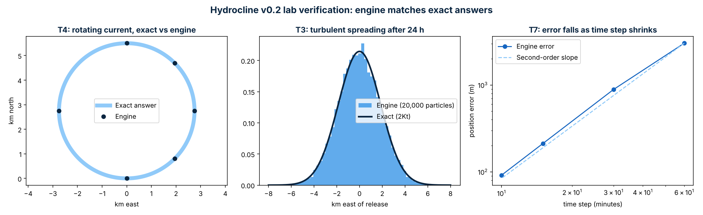
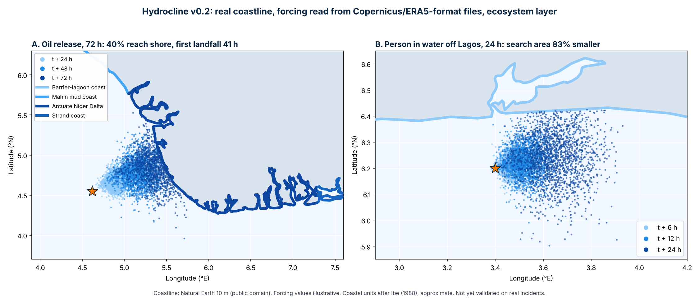

# Hydrocline: Drift Engine

Hydrocline is a proposed digital twin of the ocean for Nigeria, built for the NIMASA Blue Economy Accelerator Programme (NIMASA-BEAP) 2026. Its first module forecasts where a person in the water or an oil slick will drift, which shore it will reach, and which coastal habitats are at risk.

## Technology readiness: TRL 3 (lab proof of concept)

Every critical component is built and tested in the lab:

| Component | What it does | Evidence |
|---|---|---|
| Drift engine | 2,000-particle Monte Carlo model: current, wind drag, turbulent spreading | 8 of 8 lab tests passed against exact answers (`verification_report.md`) |
| Forcing ingestion | Reads Copernicus Marine currents and ERA5 winds in their standard NetCDF formats, in space and time | Test T5 |
| Real coastline | Natural Earth 10 m shoreline for Nigeria (public domain) | Test T6: landfall off Lagos within 6 minutes of the exact time |
| Ecosystem layer | Classifies landfall by coastal unit and sensitivity (mangrove, mud coast, sandy beach) | `demo_v02_results.md` |

**Not yet done:** validation against real incidents. That is the TRL 4 to 5 stage, using RMRCC case data and drifter buoys with `hydrocline_hindcast.py`.

## Verification highlights (v0.2)

| Test | Expected | Engine |
|---|---|---|
| Steady current, 24 h | 25.92 km | 25.89 km |
| Rotating current, 24 h | exact circle | under 1 m off |
| Turbulent spreading | sd 1.859 km | sd 1.857 km |
| Landfall on real Lagos shore | 14.41 h | 14.50 h |
| Time-step convergence | second order | order 1.8 |



## End-to-end demo (v0.2, real coastline)

| Scenario | Result |
|---|---|
| A. Oil release off the western Niger Delta, 72 h | 40% reach shore, first landfall 41 h; all landings on mangrove coast (Arcuate Niger Delta), about 67 km of shore hit |
| B. Person in water 25 km off Lagos, 24 h | 95% search area 1,937 km² vs 11,230 km² for a plain circle (83% smaller) |



The first prototype (v0.1, simplified coastline) gave 82% for scenario B, so the result holds on the real coastline.

## Files

| File | Purpose |
|---|---|
| `hydrocline_engine.py` | Core library: ingestion, drift engine, coastline, ecosystem layer |
| `verify_physics.py` | Lab verification tests, writes the report and figure |
| `run_demo_v02.py` | End-to-end demo on the real coastline |
| `hydrocline_hindcast.py` | Validation tool: replays a real event and scores it against the observed track |
| `hydrocline_drift_prototype.py` | Original v0.1 prototype |
| `nigeria_land_ne10m.geojson`, `nigeria_coastline_ne10m.geojson` | Natural Earth 10 m, clipped to Nigeria |

## Run it

```bash
pip install -r requirements.txt
python verify_physics.py      # lab tests
python run_demo_v02.py        # end-to-end demo
python hydrocline_hindcast.py --selftest
```

## Honest limits

- Demo currents and winds are **illustrative values** written in Copernicus and ERA5 formats, not observed data.
- Coastal unit boundaries follow Nigeria's four geomorphic units (after Ibe, 1988) and are **approximate**; next version uses Global Mangrove Watch habitat maps.
- **Not yet validated** against observed incidents.

## Next steps

1. Run the hindcast tool on real Copernicus Marine and ERA5 data with drifter buoy tracks in the Gulf of Guinea.
2. Back-test against anonymised past incidents with RMRCC and C4i.
3. Replace approximate coastal units with Global Mangrove Watch maps.

## Team

Elijah Chiemelie Dominic (Marine Biology, UNILAG) and Igbinosa Nosa Delight (Chemical Engineering, UNILAG).

Licence: MIT.
